# All-boss, both-phase animation review

Initial source/motion findings reviewed build `e04d5f6`; all keyframes and exact-tick browser evidence refreshed atomically from the clean final code pin `2c20398`. Twelve bosses, twenty-four phase entries, 96 exact-tick offline renders (0/60/120/240) plus 24 camera-only diagnostic boss frames. Chrome reported **zero errors**. One game-only keyframe per phase is tracked here; the other captures remain private scratch.

**Current production animation coverage: 0 clips. Bespoke animated transformations: 0/12. Boss-specific terminal animation coverage: 0/12.** Existing identity sprites and procedural canvas changes are prototype feedback. Codebreak summit has the strongest articulated prototype motion; it is still not a production clip pack.

Each row below separates actual browser/source evidence from recommended critical poses. Neutral sampling does not earn a clear or force every conditional cue. Later hatches, returning attacks, counter openings and defeat states are source-verified where not sampled. Existing base-kit fixtures are separate gameplay evidence.

## Phase-by-phase findings

### Tidebreak Marina · Fat Head Dave · Phase 1: Breakwater Tug

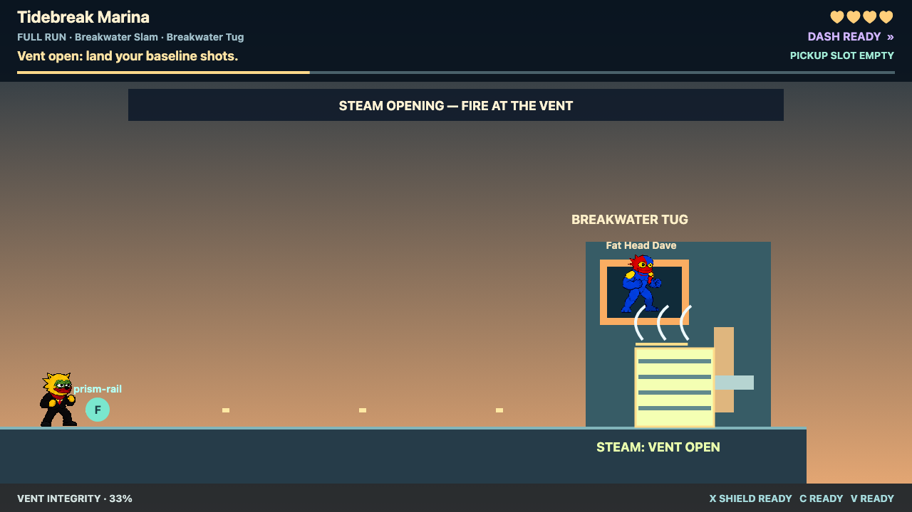

**Observed/source-verified prototype:** Piston length changes discretely; vent fill/steam linework exposes the opening. Wake warning and release are separate hazard states. Pilot sprite stays in wheelhouse; no throttle-pull articulation.

**Required critical poses:** Throttle reach → piston hang at60 → strike120 → steam180 → recoil/relock390. Ease the piston between poses without moving the low32px wake collision.

### Tidebreak Marina · Fat Head Dave · Phase 2: Dry Dock Press

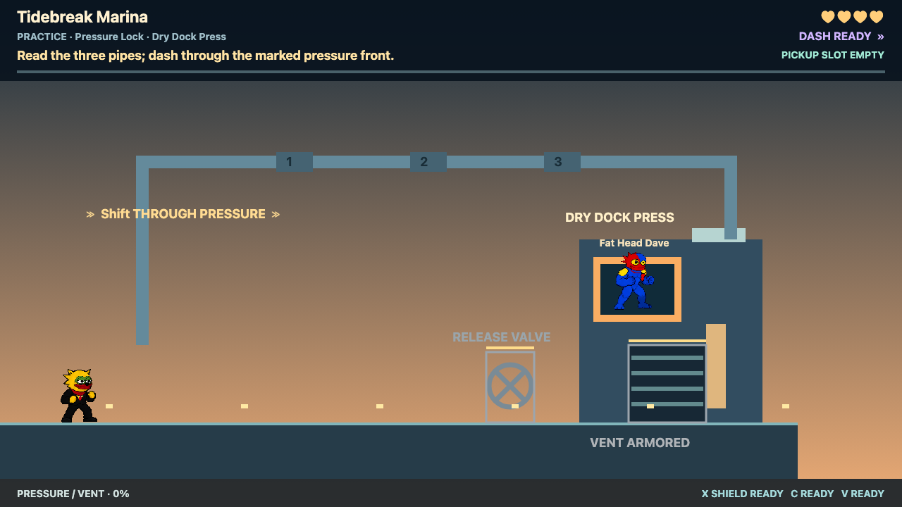

**Observed/source-verified prototype:** Pipe lights sequence and valve/vent color states are visible. Press, pipes and valve wheel are otherwise rigid; the pressure front supplies motion. Pilot remains the same fixed sprite.

**Required critical poses:** Pipe1/2/3 light → locked pressure hold → front release → valve-wheel turn only after counter → steam vent open. Keep wheelhouse/piston through docking.

### Last Light Bar · Morelight · Phase 1: Prism Projector

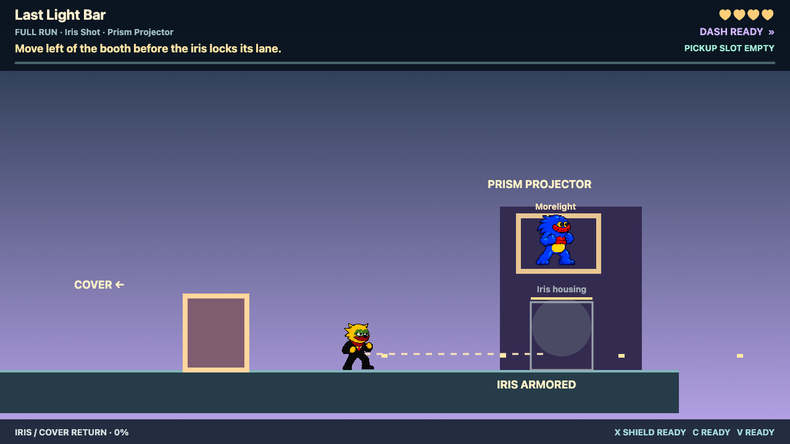

**Observed/source-verified prototype:** Iris changes fill state and a dashed line records the locked lane. Booth and projector are static. No animated lens narrowing or pilot lens control is present.

**Required critical poses:** Lens narrow60 → lane lock → beam120 → recoil/open iris210ticks → iris close. Keep booth sightline geometric, not an oversized flare.

### Last Light Bar · Morelight · Phase 2: Mirror Gantry

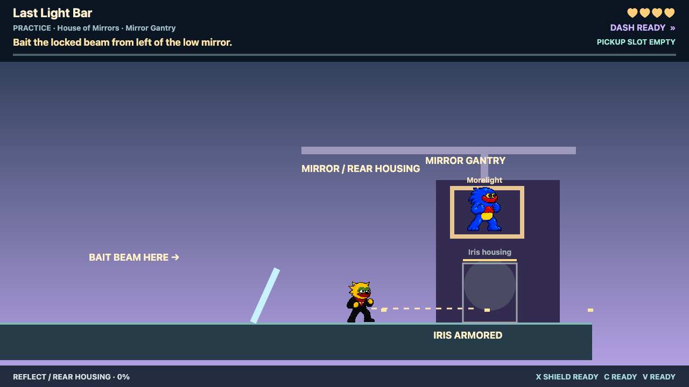

**Observed/source-verified prototype:** New rail/mirror silhouette and24tick reflected ray distinguish the phase. Mirror angle and gantry are static; no actual swing or overhead lift sequence.

**Required critical poses:** Mirror swing/stop before aim → locked incident ray → reflection flash → rear housing open → recovery. Separate reflected beam from player muzzle and housing glow.

### Mudline Trenches · Crapto · Phase 1: Sludge Dredger

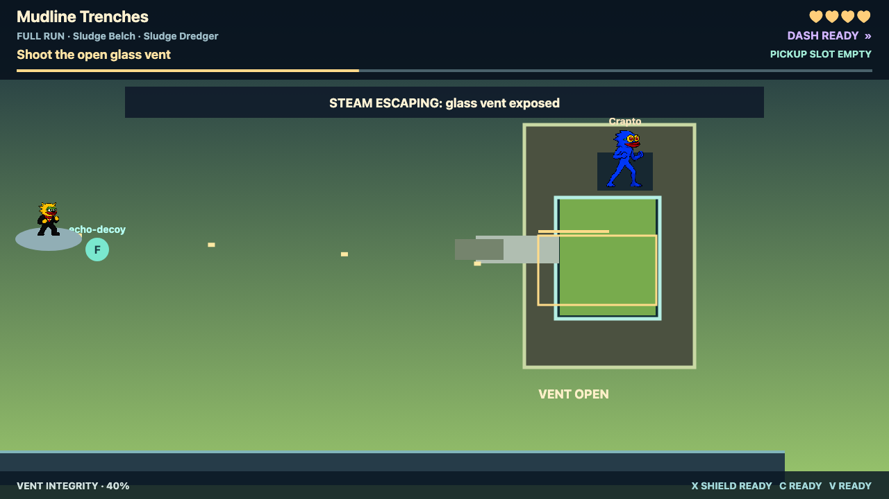

**Observed/source-verified prototype:** Glass fill rises and committed-altitude line appears; nozzle body changes tint, then an ordinary projectile moves left. Pilot is visible but does not pull a firing control.

**Required critical poses:** Belly fill0–89 → nozzle altitude lock90 → belch145 → vent steam155–299 → reseal300. Pivot nozzle toward locked altitude before release.

### Mudline Trenches · Crapto · Phase 2: Floodgate Pump

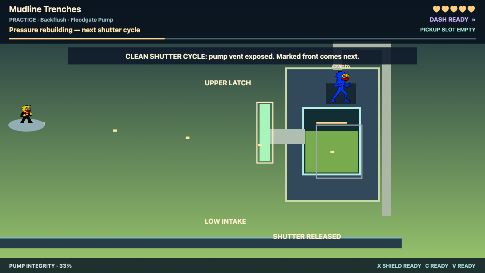

**Observed/source-verified prototype:** Upper/lower route targets, shutter status and marked front are visible. Pipe drain and shutter physical travel are not articulated; colored rectangles represent state.

**Required critical poses:** Pipe drain to selected shutter → upper latch release OR lower intake bounce impact → shutter slide → front windup90 → counter overload → glass vent expose180.

### Sproto Ranch · Halloween 2008 · Phase 1: Lantern Harvester

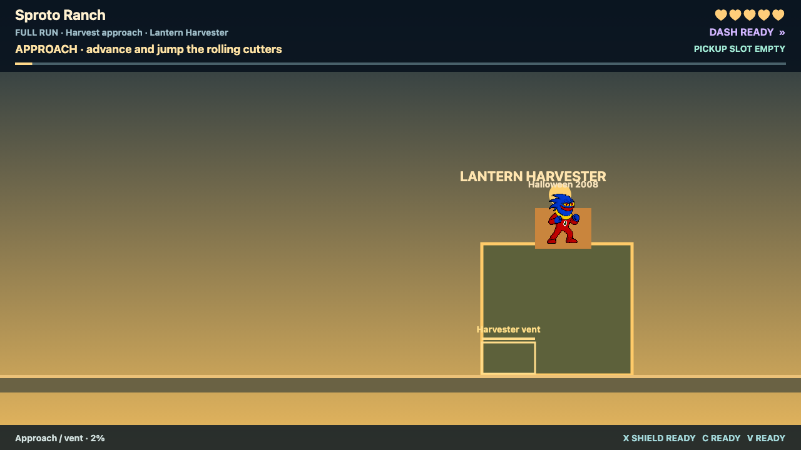

**Observed/source-verified prototype:** Lantern bobs on a decorative sine independent of roller windup. Harvester and pilot are far down-route and absent in early normal camera samples; diagnostic boss framing confirms silhouette only.

**Required critical poses:** Lantern deliberate swing → cutter rattle55 → roller release → cutter spin-down → vent recoil. Tie lantern extremes to the actual attack, not continuous bob.

### Sproto Ranch · Halloween 2008 · Phase 2: Harvest Express

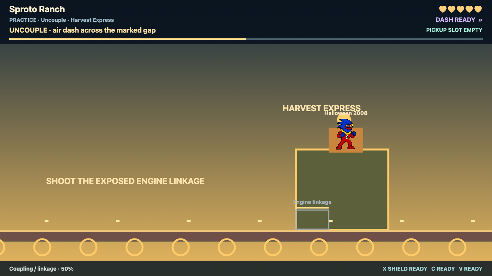

**Observed/source-verified prototype:** Cars/platforms and engine translate0.6px/tick. Coupling gap exists on entry; chain pull and uncoupling are not animated. Lantern retains its unrelated bob.

**Required critical poses:** Pilot chain pull → coupling stretch/unlatch → separate cars → marked launch hold → linkage reveal after dash → engine recoil. Keep launch edges attached to moving cars.

### Neon Tomorrow · Collector · Phase 1: Salvage Strider

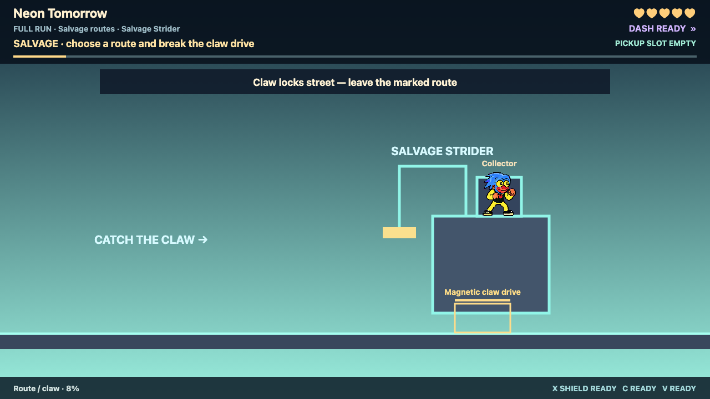

**Observed/source-verified prototype:** Authored auto-scroll and lane hazard move. Crane/claw silhouette is rigid, at far-route x4800 and outside early play samples; diagnostic framing confirms the distant cockpit.

**Required critical poses:** Collector winch crank → claw lock street/upper lane65 → magnet pulse → scrap drag150 → release30. Use claw pose, not only text, to commit the route.

### Neon Tomorrow · Collector · Phase 2: Billboard Rig

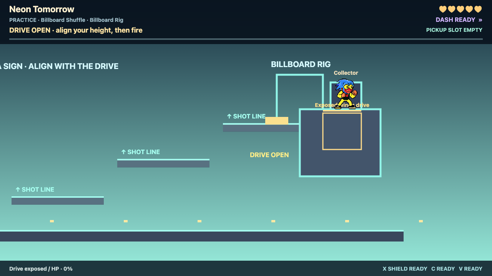

**Observed/source-verified prototype:** Signs move vertically and exposure toggles. Winch/claw remain rigid. Actual sample shows cockpit/title intersects HUD/cue region; pilot hands and cab can be obscured.

**Required critical poses:** Winch turn → sign elevation shift → drive cover open80–260 → latch/recovery. Move final cockpit silhouette/labels into safe region; preserve exact platform tops.

### Circuit Gate · Bongraker · Phase 1: Relay Walker

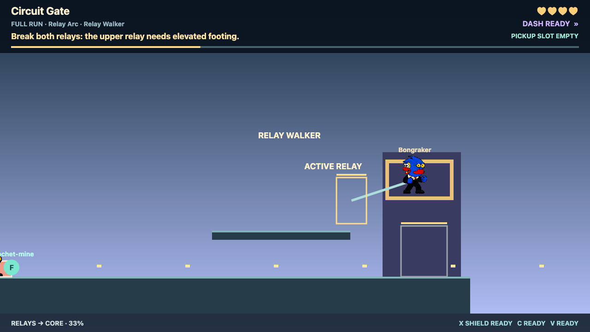

**Observed/source-verified prototype:** A charge dot traverses the visible cable while low arc becomes active. Relay state and core exposure are explicit. Walker legs and operator remain static.

**Required critical poses:** Operator relay throw → cable charge60 → arc discharge → cable cool → relay break → core iris open after both nodes. Give the cable dot a matching hand action.

### Circuit Gate · Bongraker · Phase 2: Gate Spider

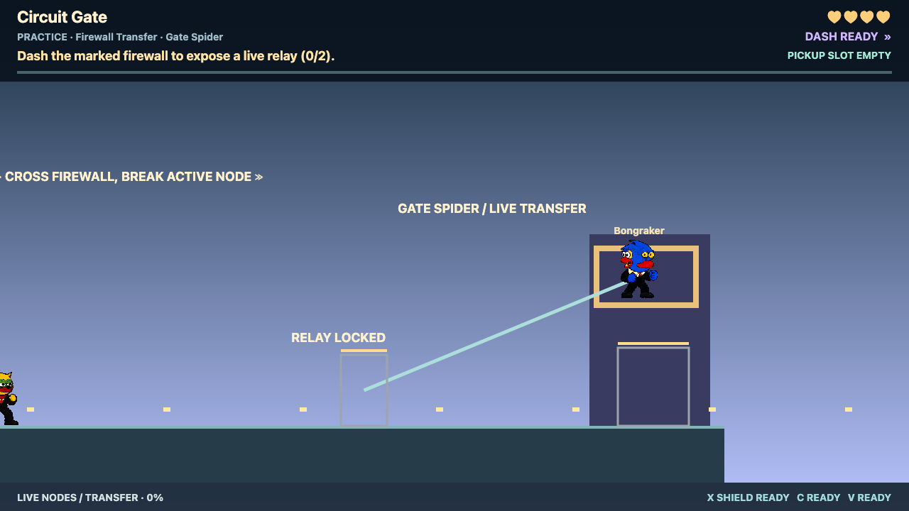

**Observed/source-verified prototype:** Dash front and live relay states convey transfer, but the Spider silhouette is the same rigid cabinet; there is no folding leg deployment or node-travel animation.

**Required critical poses:** Cockpit fold → cable tension → firewall charge90 → transfer release → live-node190tick window → reset recovery. Distinguish active node from exposed core.

### Moonkeep Castle · Big Swole · Phase 1: Siege Dragon

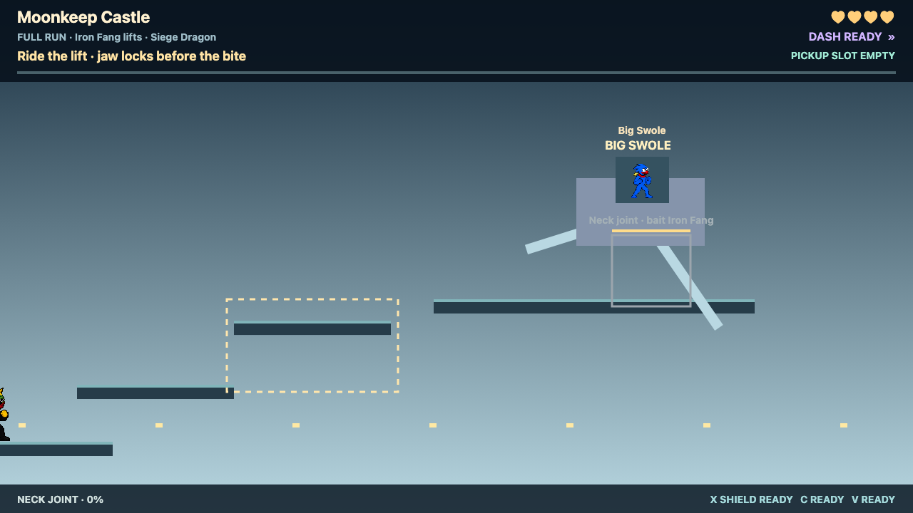

**Observed/source-verified prototype:** Lift moves and dragon neck endpoint follows a continuous sine. Bite hazard is positioned at the player, not matched by a jaw strike. Pilot is seated but has no control action.

**Required critical poses:** Jaw ratchet60 → neck coil → committed bite18 → joint withdrawal/open138–234 → recovery. Art jaw trajectory must follow actual bite box or collision must be reapproved.

### Moonkeep Castle · Big Swole · Phase 2: Rampart Dragon

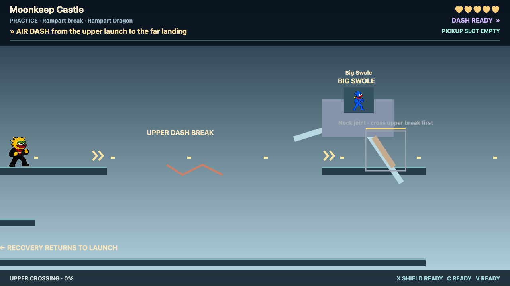

**Observed/source-verified prototype:** Added anchor leg and crack lines distinguish phase; disabled bridge is already absent. Tail windup and stone collapse are not animated; neck keeps unrelated sine motion.

**Required critical poses:** Rear feet clamp → tail windup → numbered cracks → stone break/drop → upper crossing hold → joint expose. Keep recovery route visible throughout collapse.

### Crown Relay Chamber · Alpha 777 · Phase 1: Jackpot Knight

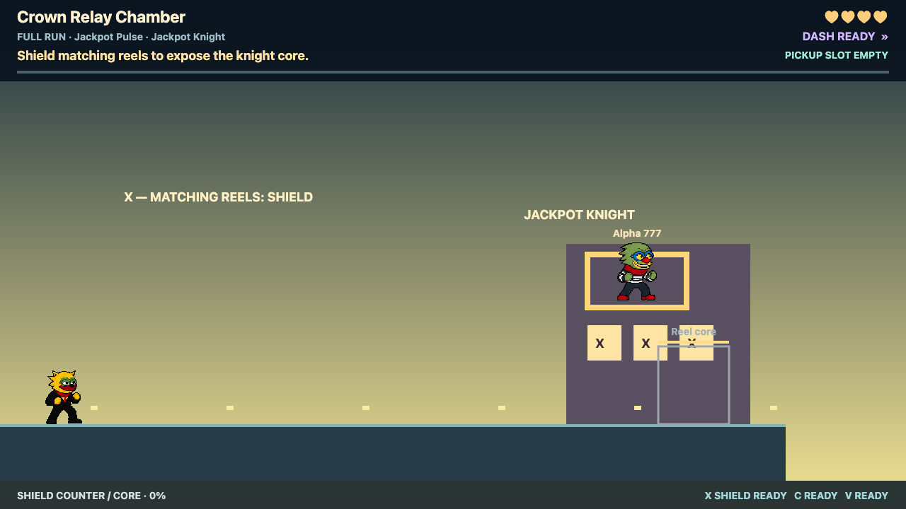

**Observed/source-verified prototype:** Three reel boxes light in sequence30/55/80 and show X. The symbols do not spin or physically stop; pilot, body and pulse emitter are static.

**Required critical poses:** Reel1 brake30 → reel2 brake55 → reel3 brake80/chime → shield pulse120 → block stagger → core open210. Preserve X shape independently of color.

### Crown Relay Chamber · Alpha 777 · Phase 2: Crown Joust Rig

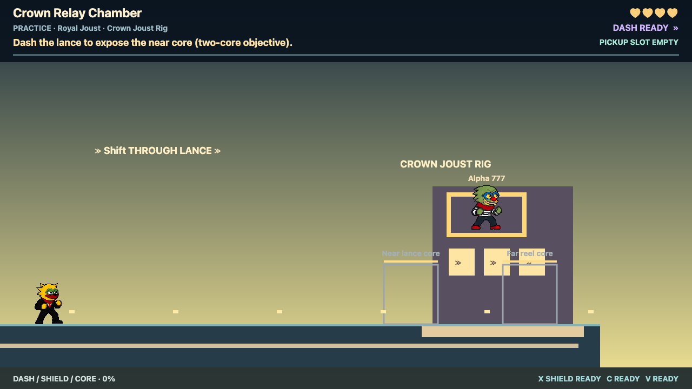

**Observed/source-verified prototype:** Rail and sled are drawn, plus alternating chevron/X cues. Sled does not recoil or joust along the rail; no lance drops, though typed fronts move correctly.

**Required critical poses:** Sled preload recoil → lance lower → chevron charge → dash-only release → near-core recovery; alternate with original reel braking and far-core shield opening.

### The Hatchery · High Sproto · Phase 1: Incubator Crane

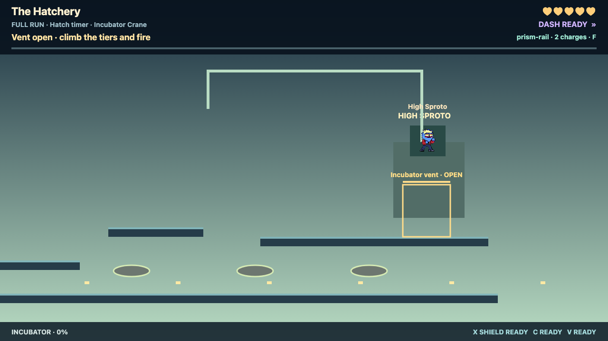

**Observed/source-verified prototype:** Pod seam/countdown and shell-vs-broken ellipse states are present. First hatch occurs300, beyond requested240tick sample range; hatch timing is source-verified only. Crane/claw stays rigid.

**Required critical poses:** Claw settle pod → seam tension/countdown → shell crack → hatch release → lost footing marker → crane vent open. Align shell collapse exactly with platform disable.

### The Hatchery · High Sproto · Phase 2: Brood Crawler

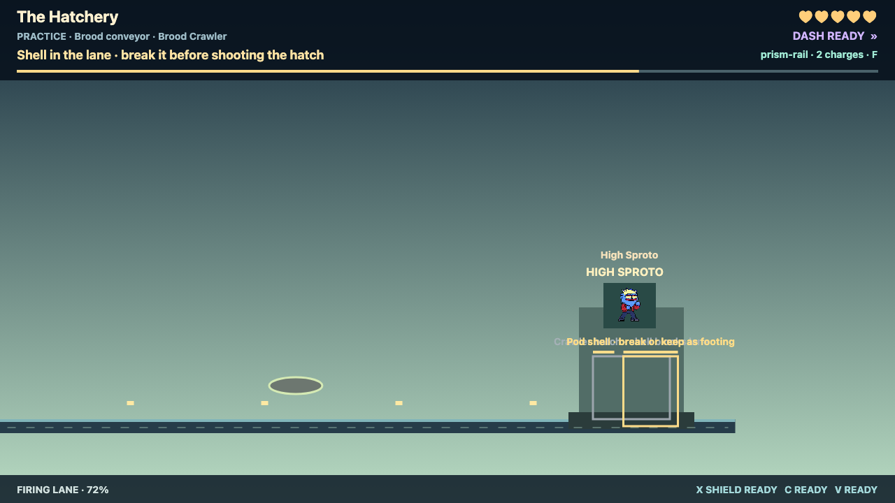

**Observed/source-verified prototype:** Pods translate and crawler hatch/cab oscillates horizontally. Pilot follows core x. Tracks and hatch do not articulate; shell destruction is a state pop.

**Required critical poses:** Track roll → conveyor index → shell hit/squash → shell break → hatch pass/open → brood release → recoil. Keep firing lane and shell occlusion truthful.

### Verse Gate · Bot Sales · Phase 1: Sales Carrier

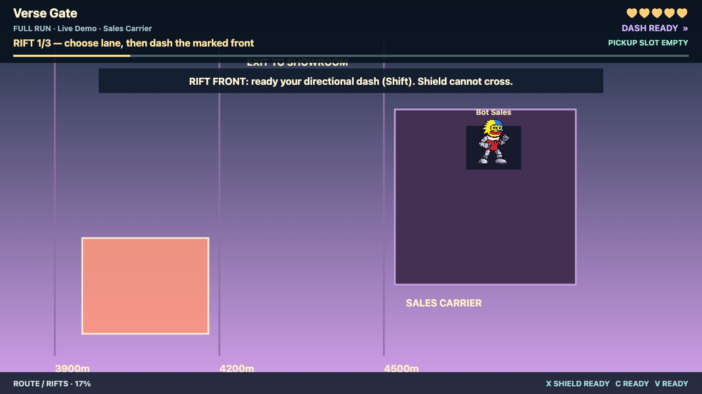

**Observed/source-verified prototype:** Route drift, debris and marked rifts move in play. SalesCarrier remains far down-route in early samples; diagnostic framing confirms rigid carrier/cabin with no drone unfold articulation.

**Required critical poses:** Module door open → drone unfold → aim lock50 → rift projector release → recoil/close. Cabin and exposed emitter must share a visible source anchor.

### Verse Gate · Bot Sales · Phase 2: Orbital Showroom

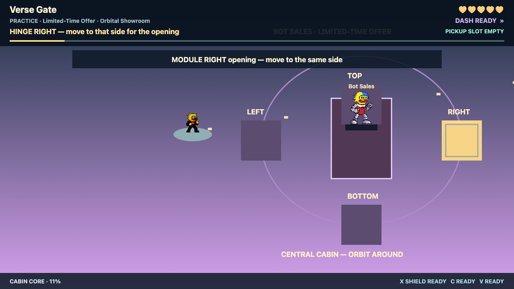

**Observed/source-verified prototype:** Exposure jumps between four fixed module positions each120ticks, with side-dependent target openings. Top target is now below cue; at120 it visually overlaps the pilot/cabin, risking weak-point ambiguity. Modules do not hinge.

**Required critical poses:** Left/top/right/bottom hinge anticipation → exposed face → recoil → close; center-lane opening420–464 needs physical split. Keep target separate from operator silhouette.

### Rooftop Breakaway · Goldie · Phase 1: Pursuit Jetpack

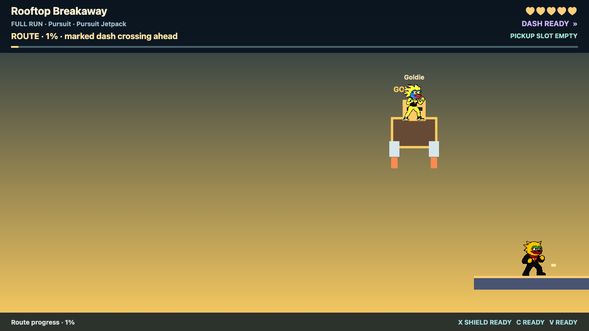

**Observed/source-verified prototype:** Jetpack and Goldie bob together with constant exhaust. At normal opening x130, pursuer is x−130 and offscreen; diagnostic framing reveals the silhouette. Arm aim/nozzle tilt are not articulated.

**Required critical poses:** Nozzle tilt → arm aim48 → afterburner burst → thrust recoil → controlled bank recovery. Sync flame pulse to actual shot release rather than static rectangles.

### Rooftop Breakaway · Goldie · Phase 2: Intercept Glider

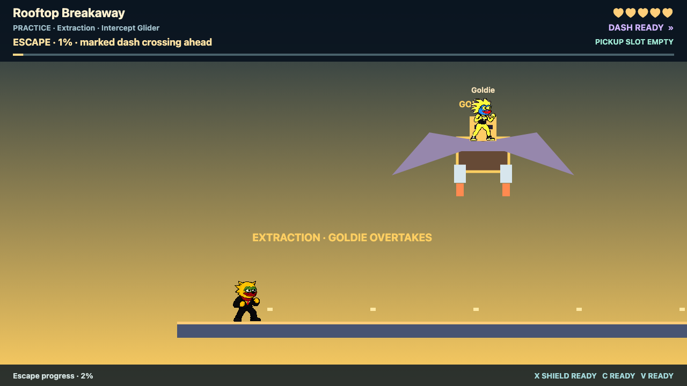

**Observed/source-verified prototype:** Glider wings are already fully deployed on entry and entire assembly bobs. Pilot tracks cockpit. No overtaking bank or intercept arm action beyond moving projectile/cue.

**Required critical poses:** Wing unfold → overtake bank → nozzle correction → intercept aim48 → cutoff shot → missed-pass recovery. Keep wing silhouette out of launch/landing cue.

### Codebreak Ascent · Bitcoin Sheriff · Phase 1: Warrant Rig

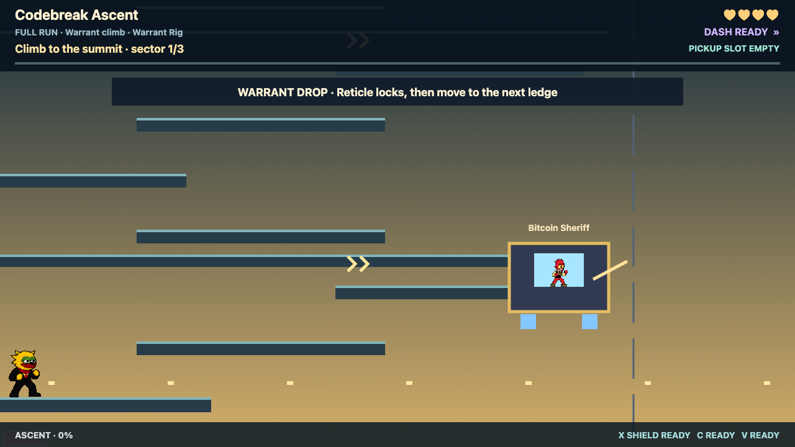

**Observed/source-verified prototype:** Rig follows climb and flame height/arm endpoint oscillate. Reticle/drop hazard cues are authored separately, but arm does not actually aim/lock to the reticle position. Pilot follows pursuing cab.

**Required critical poses:** Rocket lift/bank → reticle arm unfold → left/right lock65 → warrant stamp/drop → arm recoil/retract. Keep reticle distinct from projectile hit area.

### Codebreak Ascent · Bitcoin Sheriff · Phase 2: Summit Lockdown

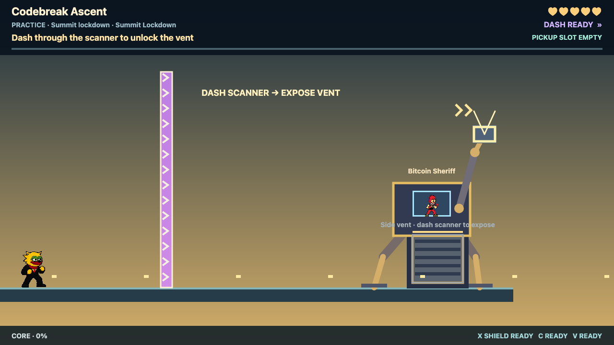

**Observed/source-verified prototype:** Actual samples show cabin settled and emitter unfolds; pure fixed-tick pose provides planted feet, jointed arm, release recoil and vent shutter articulation. Pilot follows cab. Counter-open/hit reactions are source-verified; neutral samples do not earn them.

**Required critical poses:** Approach compression0–75 → anchor → unfold55 → lock20 → release140 → retract55 → recovery; counter overload → shutter18 → real target-hit flinch. Hold feet atfloor600 and vent rectangle1050,490,105,100.

## Transformation continuity and distinct terminal outcomes

Current entry routing uses a shared90tick transformation overlay and generic clear overlay. The following are recommendations for separately authored machine-specific sequences, not completed clips. Defeat means disabling the machine; no pilot death is assumed. Goldie uses an escape outcome.

| Boss | Retained-component transformation | Distinct terminal recommendation |
|---|---|---|
| Fat Head Dave | Tug settles into a cradle; wheelhouse and piston connect physically to the pipes instead of replacing the silhouette behind the generic transition. | Pressure overload opens relief stack, piston locks safely down, tug engine sputters out; Dave releases throttle and remains visibly safe in stopped wheelhouse. |
| Morelight | Raise the existing projector on the overhead rail while retaining iris/pilot seat; fold booths away in the same camera. | Projector iris fractures internally and shutters close; gantry sags into a safety stop, Morelight lowers the controls and steps away from the dark lens. |
| Crapto | Dredger rotates/docks sideways; preserve glass belly/intake and visibly connect them to floodgate, with pilot seat orientation kept readable. | Pump backpressure vents upward, glass belly drains, shutters lower into locked-safe position; Crapto shuts the intake lever and the machine goes still. |
| Halloween 2008 | Harvester couples onto moving train; carry the lantern cab toward the engine instead of teleporting to the second phase. | Engine linkage shears, detached drive spins down and cars brake in staggered order; lantern remains lit as Halloween2008 pulls the emergency stop. |
| Collector | Crane anchors to tower; magnetic claw stays visible and sign suspension cables explain the new height decisions. | Magnet polarity flips, scrap drops into a contained bin, winch cable loses tension and signs settle onto stops; Collector parks the gantry with hands off controls. |
| Bongraker | Walker folds into gate using the same cockpit and cable routing; anchor feet before a new node lights. | Broken transfer circuit cascades through nodes, cables discharge into grounded rods and spider legs fold into the gate; Bongraker removes the relay key. |
| Big Swole | Lock rear legs into rampart while retaining neck joint and seat; avoid a body pop between the two rigid poses. | Neck joint breaks its drive pin, armored jaw settles against the battlement and tail uncoils; BigSwole dismounts onto intact rampart as the anchored machine powers down. |
| Alpha 777 | Eject the same cockpit/reels onto the rail sled; keep reel order and scale continuous. | Reels jam on mismatched symbols, lance folds away, rail brake sparks and sled rolls into a padded stop; Alpha777 raises empty hands from the intact cockpit. |
| High Sproto | Lower crane cab onto tracked incubator, retaining gauge/claw; feet must land on the existing conveyor plane. | Pressure gauge falls to zero, conveyor indexes remaining pods into safe cradles and tracks lock; HighSproto closes the incubation controls and exits the stopped cab. |
| Bot Sales | Carrier splits around central obstruction while cabin remains fixed/readable; bring the same modules into orbit rather than swapping rectangles. | Orbital modules sequentially lose power and dock around the central cabin, offer panels retract and carrier drifts away on emergency thrust; BotSales remains inside intact cabin. |
| Goldie | Reuse jetpack and unfold wings during transition; show same nozzle/pilot moving from behind player to ahead without unexplained teleport. | ESCAPE, not pilot death: Goldie banks clear of the exit, retracts aim and glides away on trailing exhaust while player reaches extraction; retain readable surviving silhouette. |
| Bitcoin Sheriff | Show pursuit rig brake/land and deploy anchors before scanner; same hat/cab/arm/gold trim. Current generic90tick overlay does not itself animate this route transformation. | Scanner overload folds emitter, vent pressure dumps, anchored knees compress and all lamps go dark in sequence; Sheriff holsters the warrant tool and exits the stopped rig. |

## Production count and approval gate

A production clip is a separately authored action with a stable ID, intentional start/end poses, timing, event markers, pivot/anchors and source/generation record. Thirty frames, sampled procedural states, reused labels or a reference SVG do not count as thirty clips. If30+clips is required for each boss, that implies at least372distinct boss clips (31×12), before weapon clips; the Codebreak36item request is also an unproduced backlog. The producer owns the exact inventory; actual integrated final clips remain0.

Before generation: approve both gameplay silhouettes, pilot hand/control linkage, each signature windup/release/recovery, retained-component transformation, actual hit area and the boss-specific terminal outcome. Test at normal gameplay size against the real HUD and arena. Keep mandatory dash contours and weak-point windows independent from decorative effects.

## Blocking findings before production

- Neon Phase2 cockpit/title overlaps the top HUD/cue. Reframe its gantry and labels before final animation.
- Verse Phase2 top module overlaps the central operator/cabin silhouette. Separate exposed target and operator visual hierarchy before production.
- Ranch, Neon and Verse route bosses are absent from the first240neutral ticks of the normal camera; diagnostic framing verifies shape, not in-play signature readability. Goldie begins off the left edge. Review approach timing with actual player movement.
- Most operator sprites are idle cutouts; none demonstrates bespoke throttle, chain, winch, relay, reel or attack-control action.
- Most attack motion is hazard geometry/text rather than machine articulation. Decorative neck/lantern/hover sine motion must be tied to attack events or intentionally reserved for idle.
- All twelve transformations and twelve distinct machine shutdown/escape sequences remain production work.

No production fixes, Higgsfield calls or Library uploads were made by this review. No human motion/comprehension/balance approval is asserted.

Review pin note: NeonPhase2visibility fix was requested after these e04d5f6 captures. Treat the captured occlusion as a baseline finding, not evidence that a later fix failed. Re-capture the changed phase on the final integration pin.

## Final clean-code refresh · e1c9dbc

Repeated all24phase entries at ticks0/60/120/240 plus24camera-only boss frames against the clean `arcade-final-check` checkout:120actualgame-only renders,zero browser errors. All24tracked representative keyframes now come from this final code pin. Historical initial-review findings above remain visible so changes are auditable.

**NeonPhase2pilot occlusion is corrected.** Final source/capture place Collector feet at285 and sprite top205, below the HUD/cue. The old screenshot finding described e04d5f6 and is superseded for pilot visibility. The title still sits close to the cue strip and the generic drive label crowds the pilot feet; those are cosmetic hierarchy recommendations. The renderer now hides explicitly inactive platforms, so a removed/crumbling foothold is no longer pictured as solid support.

This refresh remains diagnostic motion/render evidence, not earned-clear, human critical-pose signoff, production animation approval, or completed boss-specific terminal coverage. Actual final animation clips remain0.

## Atomic canvas capture correction · 2c20398

The previous tracked fixed-arena PNG selection used normal-camera samples while guide code consumed the separate diagnostic-camera metadata. Compositor screenshots also failed to guarantee same-call canvas/metadata synchronization. Those pairings are superseded.

All120frames were recaptured from clean code2c20398 by calling `ArcadeApp.render()` and `canvas.toDataURL('image/png')` in the same browser evaluation that returns the metadata. The file is the native1280×720canvas pixelbuffer, with no browser UI or asynchronous compositor screenshot. Every tracked keyframe now uses its own `trackedKeyframe` record containing file,SHA256,camera,pilot,pose,targets/hazards and exact tick; every tracked image is a diagnostic boss frame, with pilot projected toX900. This is a camera-only inspection view and may crop normal player/arena context.

All24tracked PNG hashes match the atomic diagnostic-frame records. Native-buffer visual inspection of CodebreakPhase2,VersePhase2,andCrownPhase2 confirms pilot atX900, matching their metadata. Offline rendering reported0errors. Earlier source/motion recommendations remain historical/provisional; no human approval or production-animation completion is inferred.
